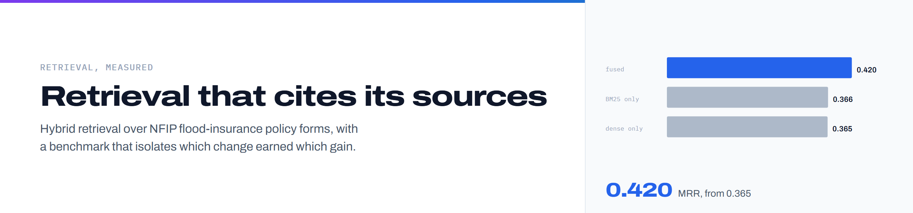
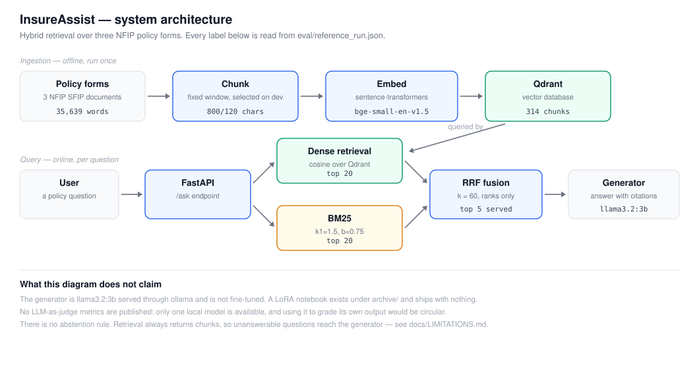
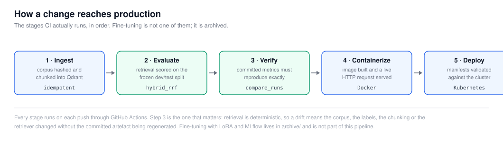

<picture>
  <source media="(prefers-color-scheme: dark)" srcset="docs/assets/header-dark.png">
  
</picture>

# InsureAssist

InsureAssist answers questions about the wording of the three NFIP Standard Flood Insurance
Policy forms and returns citations that resolve to exact character offsets in the source
regulation. It is built to be measured rather than demonstrated: every number published
here is re-derived from one artefact by a guard that CI runs, including the numbers that
look bad. It is for engineers who want to see what retrieval scores on near-duplicate legal
documents, and where it fails.


-green)

## How it is built

<picture>
  <source media="(prefers-color-scheme: dark)" srcset="docs/architecture-dark.svg">
  <source media="(prefers-color-scheme: light)" srcset="docs/architecture.svg">
  
</picture>

Ingestion chunks the three forms at 800 characters with 120 of overlap, which is 314 chunks,
embeds them with `BAAI/bge-small-en-v1.5` and writes them to Qdrant. A query runs dense
cosine search and Okapi BM25 side by side, takes 20 candidates from each, and fuses them by
reciprocal rank fusion at k=60. The top 5 go to `llama3.2:3b` through Ollama with the
offsets attached. Every label in the diagram is read from
[`eval/reference_run.json`](eval/reference_run.json), so it describes the system that
produced the numbers below rather than an intended one. Details in
[`docs/ARCHITECTURE.md`](docs/ARCHITECTURE.md).

## The result

Held-out test split. Derived from [`eval/reference_run.json`](eval/reference_run.json).

| | Hit@5 | MRR | Top-doc accuracy |
|---|---|---|---|
| *Starting point, dense, 600/100* | *0.611* | *0.366* | *0.167* |
| Dense only (BGE), 800/120 | 0.500 | 0.365 | 0.556 |
| BM25 only, 800/120 | **0.611** | 0.366 | 0.333 |
| **Hybrid RRF, selected** | 0.556 | **0.420** | **0.556** |

**Top-document accuracy 0.556**, up 3.3x from 0.167. That gain is the chunk size, not the
fusion. Dense alone at 800/120 already reaches 0.556; holding the retriever fixed and moving
600/100 to 800/120 is the whole 0.167 to 0.556. What fusion earned is the ranking: MRR 0.365  to
0.420. hit rate@5 0.556 is not an improvement on the starting point's 0.611, and BM25 alone
still retrieves more relevant chunks, 11 questions against 10, one question on a
denominator of 18.

Two things do not work, and they are measured too. The service rejects no unanswerable
question: all **9** unanswerable questions in the test split were answered
(`generation.abstention.false_answers`). And 5 of the 18 answered test questions cite a
context block that was never supplied. Both are expanded under [Limitations](#limitations).

p50 latency is **81.82 ms** over 27 questions on one machine, which is a fact about the
machine and not a property of the system.

The benchmark is **50** hand-authored labels, 32 answerable, 18 unanswerable, split
deterministically into dev 23 and test 27. The 27 test questions include 9 unanswerable
ones, which have no chunk to retrieve, so every retrieval number above is over the 18
answerable test questions. One question is 5.6 percentage points at that size, and the 95%
Wilson intervals for all three retrievers overlap at every depth.

`python -m eval.verify_artifacts` re-derives 27 documented claims from the artefacts and
fails if any document has drifted. CI runs it on every push. Full numbers, category
breakdown and failure analysis: **[`docs/BENCHMARK.md`](docs/BENCHMARK.md)**.

> On record, not yet fixed: [`docs/BENCHMARK.md`](docs/BENCHMARK.md) still reports "false
> answers 4" and "all four unanswerable test questions" at lines 107 and 174, and quotes p50
> ~50 ms at line 124, where the artefact says 9 false answers and 81.82 ms, and the figure
> printed directly above that prose already draws 9.

## Run it

The repository pins **Python 3.11**: CI installs 3.11 and the container image is built from
`python:3.11-slim`. Nothing here needs a GPU or a network beyond pip.

```bash
pip install -r requirements.txt -r requirements-dev.txt

docker compose up -d qdrant                 # Qdrant v1.19.0, host port 6533
python -m src.ingest                        # 314 chunks at 800/120
python -m eval.validate_ground_truth
python -m eval.reference_run --split test --out /tmp/reference_run.json
python -m eval.compare_runs eval/reference_run.json /tmp/reference_run.json
python -m eval.verify_artifacts             # "Documentation matches the reference run."
```

The committed artefact is left alone because the run is written to `/tmp` and compared
against it, which is what CI does. For answers rather than retrieval, add
`ollama pull llama3.2:3b` and `uvicorn src.api:app`.

```bash
pytest        # offline: no model, no Qdrant, no network
```

---

## What this is not

It answers questions *about* the text of published federal regulation. It is not insurance
advice, it does not price or underwrite anything, and it makes no recommendation: there is
no rules engine and no product suggestion anywhere in the codebase. An answer is a language
model's reading of retrieved passages, and the measured limits below are real - the service
does not reliably detect a question its corpus cannot answer, so it can answer confidently
from passages that do not contain the answer. Read the citations, which resolve to exact
character offsets, rather than the prose.

## Why this benchmark is hard

The corpus is the three **NFIP Standard Flood Insurance Policy** forms, real policy wording,
enacted as federal regulation (44 CFR Part 61) and therefore redistributable.

They are **near-duplicates by design**. All three share a skeleton and much verbatim wording,
but differ in substance: the condominium form has a coinsurance article the others lack; the
$30,000 compliance limit and the 60-day proof-of-loss deadline appear in all three. A
retriever matching on topic finds the right *provision* in the wrong *document*.

That is exactly what the original system did: it returned the correct policy form only
**17%** of the time.


## How a change reaches production

<picture>
  <source media="(prefers-color-scheme: dark)" srcset="docs/mlops-pipeline-dark.svg">
  <source media="(prefers-color-scheme: light)" srcset="docs/mlops-pipeline.svg">
  
</picture>

CI runs four jobs: **quality** (lint, corpus checksums, ground-truth validation, doc/artefact
reconciliation, offline tests), **retrieval-eval** (ingests into a real Qdrant, reproduces the
reference run, fails on drift), **container-integration** (builds the image, asserts non-root,
runs live HTTP against a real container), and **manifests**.

CI does not run a language model. Generation quality is therefore not measured in CI.

## Production boundary

`/health` is liveness. `/ready` checks the embedder, the lexical index and the vector store
and returns 503 with per-dependency status. Missing dependencies are 503, never 500; every
response carries a request ID; internal exceptions never reach the caller.

The container is non-root with pinned dependencies and a healthcheck. **Kubernetes manifests
are authored and CI-validated but have never been applied to a cluster**, and the GKE guide is
untested guidance. See [`docs/PRODUCTION.md`](docs/PRODUCTION.md).

## Limitations

- **Unanswerable questions are not detected.** Unanswerable rejection rate is 0.000. A
  similarity threshold was tested on an enlarged set of 18 unanswerable questions and
  rejected: balanced accuracy 0.802 on dev collapses to 0.556 on test, and 17 of the 18 score
  above the weakest answerable question. No similarity threshold is defensible on this data, the hardest trap scores *above* the mean
  for answerable questions. Nothing is claimed.
- **BM25 alone beats the selected hybrid on hit@5.** Hybrid was chosen for **MRR**, 0.420
  against 0.365 and 0.366. It is at **parity with dense on top-document accuracy** (0.556
  either way), so fusion cannot be credited for that number; the chunk size earned it.
  Both trade-offs are stated, not hidden.
- **Dev did not generalise**: hybrid scored 1.000 hit@5 on dev, 0.556 on test.
- **No answer-quality metrics.** Only one local model is available and grading its own output
  is circular. Citation *correctness* is measured, because that needs an entailment model
  rather than a better generator: ALCE's recall is 7/15 scoreable sentences, 0.4667
  [0.248, 0.699], and precision 5/15, 0.3333 [0.152, 0.583]. Both clear sensitivity and
  specificity floors declared before the run.
- **Two entailment judges clear the same calibration and disagree on recall by a third.**
  `DeBERTa-v3-large` reaches 0.938 calibration sensitivity against the base model's 0.844 at
  the same specificity, and scores recall 12/15, 0.8000 [0.548, 0.930], against 0.4667. The
  intervals meet only between 0.548 and 0.699, and the disagreement is one-directional: the
  large judge's supported set strictly contains the base judge's, five sentences to none.
  Precision survives it (0.3333 against 0.3600), so *most citations being redundant* holds
  either way; **no recall figure is established.** Preferring the better-calibrated judge
  after seeing its answer is the post-hoc choice the declared floors exist to prevent, so the
  human labelling pass in [`eval/citation_gold/`](eval/citation_gold/) is the adjudicator,
  and it is still unlabelled.
- **The model cites before it claims, and no prompt tried here changes it.** 12 of 16 cited
  sentences open with a citation marker rather than ending with one, and 16 of 16 do under a
  variant that states the valid range. Paired on the 13 questions that cited something under
  both prompts, 12 lead under both: McNemar p = 1.0. The `[n]` convention assumes the marker
  follows the statement it supports, so a marker preceding every claim leaves the attachment
  ambiguous, the offsets resolve exactly, and they cannot say which sentence they belong to.
  This is also what corrupted the first correctness figure, stranding punctuation at the
  front of nine hypotheses and emptying one. Measured without a judge by
  [`eval/citation_placement_run.py`](eval/citation_placement_run.py).
- **28% of answers cite a block that was never supplied.** The prompt numbers five context
  blocks; on the 18 answerable test questions the model produced `[6]`, `[7]` and `[16]`,
  5 of 18, 27.8% [12.5%, 50.9%]. Every answer cited something, so the failure is a dangling
  reference rather than a missing one. The `citations` field itself still resolves to exact
  offsets, because it lists the retrieved blocks rather than the ones the answer used, mean
  coverage 27.8%, so most listed citations support nothing in the text beside them. Measured
  without a judge by [`eval/citation_run.py`](eval/citation_run.py); these are facts about
  the string, not opinions about the answer.
- **One jurisdiction, one peril, three documents.** Results do not transfer.
- **Fine-tuning is archived, not used**, its training data was the old evaluation set. See
  [`archive/README.md`](archive/README.md).


Full list: [`docs/LIMITATIONS.md`](docs/LIMITATIONS.md).

<details>
<summary><b>Hardware acceleration, ingest on the accelerator, serve from the CPU</b></summary>

The embedder is the only component a GPU changes. BM25 is pure Python over a few hundred
chunks, and generation is a separate Ollama process. So the question is narrow: does moving
`BAAI/bge-small-en-v1.5` off the CPU help?

For ingestion yes, for serving no. Measured by
[`scripts/benchmark_embedding.py`](scripts/benchmark_embedding.py), median of 10 corpus
passes and 50 query passes after warm-up:

| Workload | CPU (Core Ultra 9 285H) | Intel Arc Pro 140T | |
|---|---|---|---|
| Whole corpus, 314 chunks, ingestion | 11,408 ms | **2,635 ms** | 4.3x faster |
| One short query, serving | **17.2 ms** | 30.4 ms | 0.57x, slower |

A single 40-character query does not fill the device, so dispatch and transfer cost more
than the work saved. Batching 314 chunks does fill it. The useful conclusion is to ingest
on the accelerator and serve from the CPU, which is what the numbers say rather than what a
GPU is generally assumed to do.

The two sets of vectors agree to a minimum cosine similarity of **0.99999988**, so the
choice does not move retrieval. That is checked rather than assumed, because these
embeddings are normalised and searched by cosine distance: a device that shifted them would
change which chunk comes back, and a speed-up bought that way would not be one.

Timings describe this machine. Nothing in CI depends on a GPU.

</details>

<details>
<summary><b>Figures, all six generated from the reference run</b></summary>

All six are generated from [`eval/reference_run.json`](eval/reference_run.json) by one
script, so none of them can disagree with the published result:

```bash
python scripts/figures/generate_figures.py    # the six charts
python scripts/figures/generate_diagrams.py   # architecture and pipeline SVGs
```

| Figure | What it shows |
|---|---|
| [Retrieval scorecard](docs/figures/01_retrieval_scorecard.png) | hybrid against both baselines, with the question count behind every rate |
| [Confidence intervals](docs/figures/02_confidence_intervals.png) | the same numbers with 95% Wilson intervals, they all overlap |
| [By category](docs/figures/03_by_category.png) | where retrieval fails, and how few questions each category holds |
| [Benchmark composition](docs/figures/04_benchmark_composition.png) | the corpus and the 50 questions |
| [Abstention and citations](docs/figures/05_abstention_and_citations.png) | the part that does not work |
| [Chunking sweep](docs/figures/06_chunking_sweep.png) | why the chunks are 800 characters |


`numeric_limit` and `single_chunk` retrieve nothing relevant in the top 5, but they hold
two questions each, so "0 of 2" is the whole story. The category worth acting on is
`near_miss`, at 2 of 5.

</details>

## Evidence

| | |
|---|---|
| Reference run | [`eval/reference_run.json`](eval/reference_run.json) |
| Citation use by the generator | [`eval/citation_structure.json`](eval/citation_structure.json) |
| Frozen retrieval config | [`eval/retrieval_config.json`](eval/retrieval_config.json) |
| Ground truth (50 labels) | [`eval/ground_truth/`](eval/ground_truth/) |
| Dev selection evidence | [`eval/dev_comparison.json`](eval/dev_comparison.json), [`eval/dev_chunking_sweep.json`](eval/dev_chunking_sweep.json) |
| Corpus + provenance | [`data/corpus/manifest.json`](data/corpus/manifest.json), [`docs/DATA.md`](docs/DATA.md) |
| Methodology | [`docs/EVALUATION.md`](docs/EVALUATION.md) |

## License

The [MIT License](LICENSE) covers **the code only**. The NFIP forms under `data/corpus/` are
US Government works carrying no copyright (17 U.S.C. 105) and are not relicensed here, see
[`NOTICE`](NOTICE).
