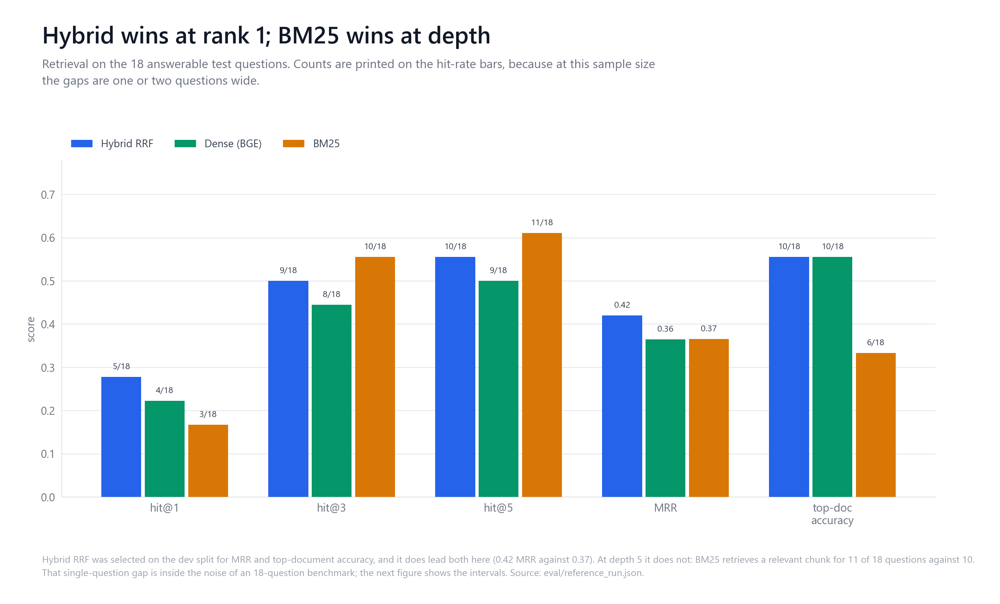
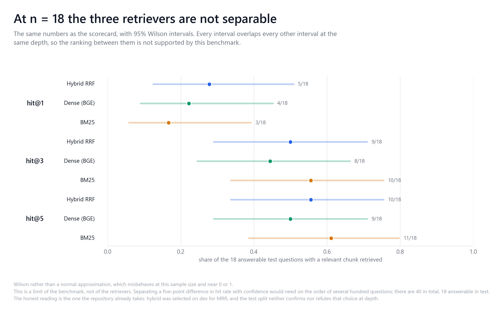
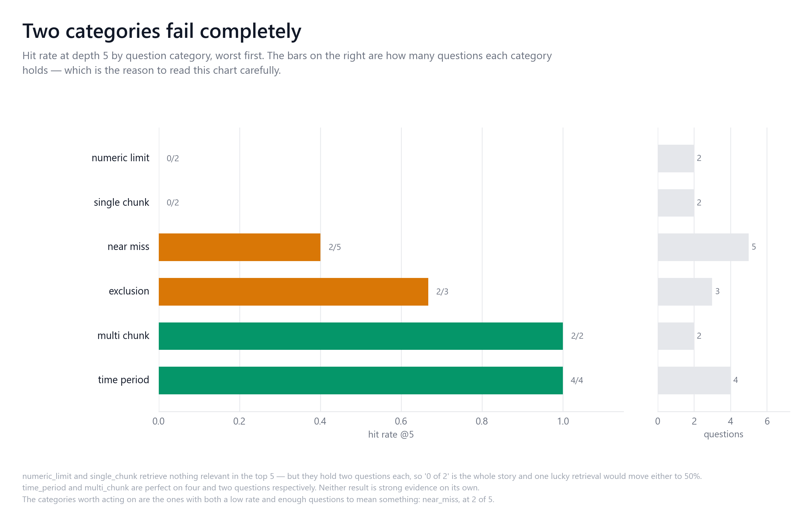
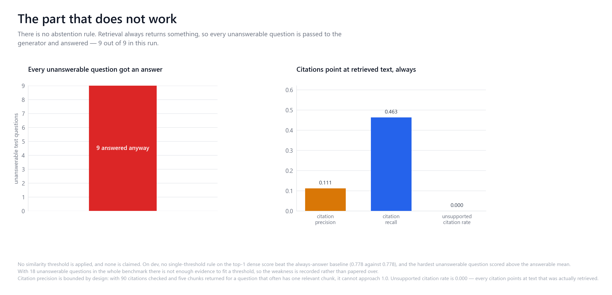

# NFIP retrieval benchmark

One question: **given a question about a flood policy, does the retriever return the passage
that answers it?**

Every number here is derived from [`eval/reference_run.json`](../eval/reference_run.json).
`python -m eval.verify_artifacts` fails if this document drifts from it, and CI runs that.

## What it measures against

- **Corpus:** 3 NFIP policy forms, 35,639 words, **314 chunks** at 800/120 ([`DATA.md`](DATA.md)).
- **Questions:** 50 hand-authored labels — 32 answerable, 18 unanswerable (36%).
- **Split:** deterministic hash of the question ID, stratified by category. Dev 23, test 27.
- **Retrieval denominator:** the 27 test questions include 9 unanswerable ones, which have
  no relevant chunk to retrieve. Every retrieval number on this page is therefore over the
  **18 answerable test questions**. At that size one question is 5.6 percentage points, so
  the gaps between the three retrievers are one or two questions wide — see
  [`figures/02_confidence_intervals.png`](figures/02_confidence_intervals.png).
- Dev drove every architecture and configuration decision. **Test was run once, after the
  configuration was frozen in [`eval/retrieval_config.json`](../eval/retrieval_config.json).**

## Final architecture

**Hybrid: dense BGE + Okapi BM25, fused by reciprocal rank fusion.** Chunking 800/120,
20 candidates per retriever, RRF k=60, serving top_k=5.

## Held-out TEST results

| Metric | @1 | @3 | @5 |
|---|---|---|---|
| Hit rate | 0.278 | 0.500 | **0.556** |
| Recall | 0.241 | 0.407 | 0.463 |
| Precision | 0.278 | 0.167 | 0.111 |

MRR **0.420** · top-document accuracy **0.556**

### Baseline comparison, same corpus, same labels, same split

| | Hit@5 | MRR | Top-doc |
|---|---|---|---|
| Dense only | 0.500 | 0.365 | 0.556 |
| BM25 only | **0.611** | 0.366 | 0.333 |
| **Hybrid RRF (selected)** | 0.556 | **0.420** | **0.556** |
| *Dense at the original 600/100 config* | *0.611* | *0.366* | *0.167* |



**Read this honestly.** The selected architecture wins on MRR and ties the best
top-document accuracy, but **BM25 alone retrieves more relevant chunks in the top 5**. In
counts that is 11 of 18 questions against 10 — a one-question gap, and the 95% Wilson
intervals for all three retrievers overlap at every depth:



The
headline improvement over the starting point is top-document accuracy: **0.167 → 0.556**,
a 3.3× reduction in returning the wrong policy form. Overall hit@5 did not improve on the
original dense baseline.

### Dev did not generalise

Hybrid scored hit@5 **1.000** on dev and **0.556** on test. That gap is the honest cost of
selecting on 14 answerable questions. The dev figure was flagged as small-sample when the
configuration was frozen, and it is reported here rather than quietly dropped.

### By category (test)

| Category | n | Hit@5 | MRR |
|---|---|---|---|
| time_period | 4 | 1.000 | 1.000 |
| multi_chunk | 2 | 1.000 | 0.750 |
| exclusion | 3 | 0.667 | 0.333 |
| near_miss | 5 | 0.400 | 0.150 |
| numeric_limit | 2 | 0.000 | 0.083 |
| single_chunk | 2 | 0.000 | 0.071 |

Near-miss questions remain the weakest substantial category — the three forms are still
being confused, just less often. `numeric_limit` and `single_chunk` are n=2 each and should
not be read as findings.

Per-form numbers are in the artefact and are **not reproduced here**: with 3–8 answerable
questions per form they carry no useful signal.

## Citations

Deterministic, no model involved.

| | Value |
|---|---|
| Citation precision | 0.111 |
| Citation recall | 0.463 |
| **Unsupported citation rate** | **0.000** |
| Citations checked | 90 |

Precision is bounded by construction: most questions have one relevant chunk and five are
returned, so 0.2 is the ceiling. The number that matters is **unsupported = 0.000** — every
citation's offsets reproduce its quoted text from the committed corpus. No provenance is
fabricated.

## Abstention

| | Value |
|---|---|
| Answerable acceptance | 1.000 |
| Unanswerable rejection | **0.000** |
| False abstentions | 0 |
| False answers | 4 |

**The service does not detect unanswerable questions, and no threshold is claimed.** On dev,
the best single-threshold rule on top-1 dense similarity scored 0.778 — exactly the
always-answer baseline. The hardest trap (`nfip-034`: coinsurance asked of a form that has
no coinsurance article) scored 0.787, *above* the answerable mean of 0.761. Any cut-off
catching it would reject most real questions.

Only the structural case is implemented: retrieval returns nothing → `insufficient_evidence`.
On this corpus that never fires, so unanswerable rejection is 0.000. This is a real
weakness, recorded as one.

## What these numbers do not say

- Nothing about **answer quality**. No judge metrics are published — only one local model is
  available and grading its own output is circular.
- Nothing about **other domains**. One jurisdiction, one peril, three documents.
- **Latency** (p50 ~50 ms local) is machine-specific and is not a system property.

## Reproducing

```bash
docker compose up -d qdrant
QDRANT_COLLECTION=nfip_sfip python -m src.ingest
python -m eval.validate_ground_truth
QDRANT_COLLECTION=nfip_sfip python -m eval.reference_run --split test
python -m eval.failure_analysis --run eval/reference_run.json
python -m eval.verify_artifacts
```

Dev-selection evidence is in [`eval/dev_comparison.json`](../eval/dev_comparison.json) and
[`eval/dev_chunking_sweep.json`](../eval/dev_chunking_sweep.json). The pre-selection dense
baseline is preserved under [`eval/baselines/`](../eval/baselines/).

`eval/dev_chunking_sweep.json` predates any script that produces it. The selection step can
now be re-run with [`eval/chunking_sweep.py`](../eval/chunking_sweep.py), which re-derives
relevance at each chunk size from the evidence spans (the rule reproduces the stored labels
at 800/120 exactly), runs dense retrieval on DEV only, and writes
`eval/dev_chunking_sweep_reproduced.json` beside the original rather than over it. With
`--mlflow` each configuration is logged as a nested MLflow run:

```bash
pip install -r requirements-mlops.txt
python -m eval.chunking_sweep --mlflow
mlflow ui        # http://127.0.0.1:5000
```

#### What re-running it actually produced

Run on 18 October 2026, Python 3.11.14, `mlflow==3.17.1`, five configurations
logged as nested runs under the MLflow experiment `insureassist-chunking`.
Original rows are the `depth=10` rows of `eval/dev_chunking_sweep.json`, which is
the depth the script uses.

| Config | Chunks, stored / re-derived | Hit@5 stored | Hit@5 re-derived | MRR stored | MRR re-derived | Top-doc stored | Top-doc re-derived |
|---|---|---|---|---|---|---|---|
| 400/80 | 664 / 664 | 0.4286 | 0.5000 | 0.3824 | 0.3786 | 0.5000 | 0.5000 |
| 600/100 | 426 / 426 | 0.6429 | 0.6429 | 0.4923 | 0.4202 | 0.5000 | 0.3571 |
| 600/150 | 474 / 474 | 0.7143 | 0.7143 | 0.5185 | 0.3655 | 0.5000 | 0.4286 |
| **800/120** | **314 / 314** | **1.0000** | **0.8571** | **0.6214** | **0.5649** | **0.5714** | **0.5000** |
| 1000/150 | 251 / 251 | 0.7143 | 0.7143 | 0.6015 | 0.3495 | 0.6429 | 0.5000 |

**The chunking reproduces exactly. The retrieval metrics do not.**

Chunk counts match at all five settings, so the chunker is doing identically what
it did before. Beyond that the two disagree: at 800/120 every one of the six
metrics differs, and no configuration had an unscorable question, so this is not
questions being dropped. The relevance labels are not the cause either - the rule
reproduces the stored `relevant_chunk_ids` at 800/120 exactly, and
`tests/test_chunking_sweep.py` fails the run if it ever does not. What differs is
which chunks come back, which points at the embedding step.

The stored numbers are not a one-off: `eval/retrieval_config.json`'s
`dev_selection` block carries hit@5 1.000, MRR 0.6214 and top-doc 0.5714, the
same row. Two committed artefacts agree with each other, and this run disagrees
with both.

The likeliest reason is that **the embedder was only ever pinned by name.**
`cfg.EMBEDDING_MODEL` is `BAAI/bge-small-en-v1.5` with no revision, so a
different snapshot can be served for the same name, and nothing recorded the
version of the stack that produced the original file. This run used
`sentence-transformers 5.7.0`, `transformers 5.20.1`, `torch 2.14.1+cpu`,
`numpy 2.4.6`. That is a candidate cause, not a demonstrated one: pinning a
revision and re-running is what would settle it, and that has not been done.

**What survives and what does not.** The decision survives: 800/120 still has the
best hit@5 and the best MRR of the five, so it is still what this grid selects,
and the reasoning in the `chunking` note above is unaffected. What does not
survive is the precision of the stored figures. The dev hit@5 of **1.000** in
particular should be read as the small-sample result its own caveat already calls
it - 14 questions, and a re-run lands at 0.857.

None of this touches the headline test-split numbers in this document. Those come
from `eval/reference_run.json` on the test split, a different artefact produced by
a different script, and the dev sweep is only the record of how 800/120 was
chosen.


---

## The figures

Every figure is generated from [`eval/reference_run.json`](../eval/reference_run.json) by
one tracked script, so none of them can disagree with the published result:

```bash
python scripts/figures/generate_figures.py
```

| Figure | What it shows |
|---|---|
| [Retrieval scorecard](figures/01_retrieval_scorecard.png) | hybrid against both baselines, with the question count behind every rate |
| [Confidence intervals](figures/02_confidence_intervals.png) | the same numbers with 95% Wilson intervals — they all overlap |
| [By category](figures/03_by_category.png) | where retrieval fails, and how few questions each category holds |
| [Benchmark composition](figures/04_benchmark_composition.png) | the corpus and the 50 questions, by category and difficulty |
| [Abstention and citations](figures/05_abstention_and_citations.png) | the part that does not work |
| [Chunking sweep](figures/06_chunking_sweep.png) | why the chunks are 800 characters |

### Where retrieval fails



`numeric_limit` and `single_chunk` retrieve nothing relevant in the top 5, but hold two
questions each — "0 of 2" is the entire result. The category worth acting on is
`near_miss`: 2 of 5, on the largest answerable category in the test split.

### The part that does not work



There is no abstention rule, so all four unanswerable test questions were answered. That
is recorded rather than hidden, and the reason no threshold is fitted is in
[`LIMITATIONS.md`](LIMITATIONS.md).
